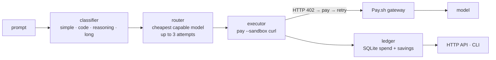

# SolRouter

**Stop paying premium prices for easy prompts.** SolRouter reads each prompt, sends it to the
cheapest model that can handle it, and pays for the call over HTTP 402 with
[Pay.sh](https://solana.com/docs/payments/pay-sh) stablecoins on Solana. No API keys, no
subscriptions: every call is paid for individually.


In the bundled demo, five prompts cost **$0.037 instead of $0.10** at premium-only prices:
**63% saved**, with the same answers.

```text
❯ What is the capital of France?
The capital of France is Paris.
── mock-tiny · simple · $0.0010 · saved $0.0190 · mock-tiny · payment: simulated

❯ Write a python function that reverses a linked list
Here's an iterative solution in O(n) time and O(1) space: …
── mock-mid · code · $0.0050 · saved $0.0150 · mock-mid · payment: simulated

❯ Why does proof of stake need slashing? Explain step by step.
Proof of stake needs slashing because staking alone doesn't make misbehaviour costly. …
── mock-big · reasoning · $0.0200 · saved $0.0000 · mock-big · payment: simulated

❯ [fail:tiny] what is 2+2?
2 + 2 = 4.
── mock-mid · simple · $0.0060 · saved $0.0140 · mock-tiny ✗ → mock-mid · payment: simulated
```

The last prompt shows the fallback: the cheap model returned nothing, so SolRouter moved up a
tier and still came in under the premium price.

## Try it in 2 minutes

Needs Python 3.11+, Node 20+ and curl.

```sh
git clone https://github.com/YusufElloumi/solrouter.git
cd solrouter/solrouter
python3 -m venv .venv && .venv/bin/pip install -r requirements.txt
npm install -g @solana/pay      # Pay.sh CLI (or: brew install pay)
./demo.sh
```

The demo shows a real **HTTP 402**, routes five prompts, rejects one that breaks its
**budget cap**, and prints the savings from `GET /stats`.

## How it works



| Prompt looks like | Category | Model tier | Price per call |
|---|---|---|---|
| Short question | `simple` | cheap | $0.001 |
| Code keywords or a code fence | `code` | mid | $0.005 |
| 4,000+ characters | `long_context` | mid | $0.005 |
| "why", "explain", "step by step" | `reasoning` | premium | $0.02 |

- **Fallback:** a failed or empty answer moves to the next model, up to three attempts.
- **Budget caps:** per-request and daily limits reject anything that would overspend.
- **Ledger:** every call is recorded with its cost and the premium baseline, so savings are measured, not guessed.
- **Sells itself too:** SolRouter's own `/ask` sits behind a Pay.sh gateway at $0.01 per call.

**What is real:** the Pay.sh CLI and gateways, the 402 challenges, routing, fallback, caps and
ledger. **What is mocked:** the models, which return canned answers. The sample output above is
from a run where Pay.sh's hosted balance check was down, so the payment step was simulated at
the price the gateway quoted. Full details, API reference and known issues are in
[`solrouter/README.md`](solrouter/README.md).

---

## Built in a Claude Code workspace for Solana

SolRouter was built inside this repo's Claude Code setup for Solana (Anchor / Kit / Surfpool):
a drop-in `.claude/` + `CLAUDE.md` + `.mcp.json`, designed around three ideas:

1. **Context is cheap to load, expensive to keep.** `CLAUDE.md` stays under 100 lines of always-true facts. Everything else lives in path-scoped `.claude/rules/*.md` (loads only when Claude touches matching files) or skills (load only when invoked).
2. **Guardrails are enforced, not requested.** Permission deny rules + `PreToolUse` hooks make keypair access, mainnet mutation, and generated-code edits mechanically impossible, regardless of what the model decides.
3. **Fresh knowledge beats memory.** The official Solana MCP server and the Solana Foundation `solana-dev` skill are wired in so Claude checks current Anchor/Kit APIs instead of guessing from training data.

### Layout

```
CLAUDE.md                         project facts, commands, conventions, workflow  (~95 lines)
CLAUDE.local.md.example           personal notes template (gitignored once copied)
.mcp.json                         Solana Developer MCP (mcp.solana.com) + Context7
.gitignore                        anchor/node/secrets/claude-local ignores
scripts/setup.sh                  toolchain check, hook chmod, installs solana-dev skill
.claude/
  settings.json                   permissions (allow/ask/deny), env (NO_DNA=1), hooks
  settings.local.json.example     per-developer overrides (acceptEdits, notifications)
  rules/
    security.md                   always loaded — audit checklist + operational rules
    anchor-programs.md            paths: programs/**/*.rs — structure, idioms, deps, verification
    tests.md                      paths: tests/**, programs/**/tests/** — harness choice, coverage rules
    client.md                     paths: app/**, clients/**, scripts/**/*.ts — Kit/Codama rules
  hooks/
    session-context.sh            SessionStart: toolchain versions, CLI cluster, Anchor.toml programs
    protect-secrets.sh            PreToolUse Read/Edit/Write: blocks keypairs, .env, generated code
    guard-bash.sh                 PreToolUse Bash: denies secret dumps / keypair overwrite / piped installers; asks on mainnet or deploy
    format-on-edit.sh             PostToolUse: rustfmt / prettier / taplo
    post-build-check.sh           PostToolUse (anchor build): declare_id! == keypair == Anchor.toml, IDL vs client freshness
  skills/
    new-instruction/              /new-instruction <program> <ix> — full scaffold incl. tests + client regen
    audit/                        /audit [--diff|program] — security audit in an isolated context
    deploy/                       /deploy <cluster> — the only sanctioned deploy path (model can't self-invoke)
    test/                         /test — run suite + Anchor error-code triage table
    cu-profile/                   /cu-profile <program> <ix> — CU measurement + optimization playbook
    solana-dev/                   (installed by setup.sh) Solana Foundation's official skill + references
  agents/
    solana-docs.md                haiku doc-lookup via Solana MCP, no CLAUDE.md
```

### Install

**New project**
```bash
anchor init my-program --test-template litesvm --package-manager pnpm --install-agent-skills
cd my-program
# copy this scaffold's files in (CLAUDE.md, .mcp.json, .claude/, scripts/, merge .gitignore)
bash scripts/setup.sh
claude
```

**Existing project** — copy the same files into the repo root; if you already have a `.claude/settings.json`, merge the `permissions` and `hooks` blocks rather than overwriting. Then `bash scripts/setup.sh`.

In the first session run `/context` (confirm CLAUDE.md + 4 rules loaded), `/mcp` (trust `solana-mcp`), and `/hooks` (see the hooks registered).

### Daily flow

| You type | What happens |
|---|---|
| `add a withdraw instruction to vault that ...` | Claude loads `anchor-programs.md`, designs accounts/constraints first, then likely invokes `/new-instruction` |
| `/test` | runs `anchor test`, maps Anchor error codes to causes |
| `/audit --diff` | audits changed files in an isolated context, returns a severity-ranked report |
| `/cu-profile vault withdraw` | baseline CU → optimizations → pinned budget test |
| `/deploy devnet` | preflight, explicit confirmation, deploy, IDL upload, post-deploy record |

### Why these specific choices

- **`NO_DNA=1`** in `env`: Anchor and Surfpool detect a non-human operator and drop TUIs/prompts for parseable output.
- **Deny on `Read(…keypair.json)` *and* a Bash hook**: permission deny rules only cover Claude's file tools; `cat target/deploy/x-keypair.json` needs the hook. Both exist.
- **`ask` instead of `deny` for deploys**: you still deploy from the session, but every deploy is a visible approval with the cluster in the prompt.
- **`disable-model-invocation: true` on `/deploy`**: Claude can't decide to deploy because the code "looks ready"; only you can type it.
- **Path-scoped rules** instead of one giant CLAUDE.md: the TS rules never consume context while you're in Rust, and vice-versa.

### Customize

- Tighten/loosen `permissions.allow` in `.claude/settings.local.json` (gitignored) rather than the committed file.
- Add CU budgets per instruction in `.claude/rules/anchor-programs.md` once measured.
- Pinocchio instead of Anchor? Swap `anchor-programs.md` for a `pinocchio-programs.md` rule with `paths: programs/**/*.rs` and update the Stack section of `CLAUDE.md`; the hooks and agents are framework-agnostic.
- Run `/doctor prompt-audit` quarterly — it flags stale instructions and files that contradict each other.

### Versions this scaffold assumes (Nov 2026)

Anchor 1.x.x · Solana CLI (Agave) · Surfpool · Rust 1.89+ · Node 20.18+ · `@anchor-lang/core` · `@solana/kit` 8 · Claude Code 2.1.2xx+ (for `.claude/rules/` `paths:` frontmatter and hook `if:` filters). Check `.claude/skills/solana-dev/references/compatibility-matrix.md` after `setup.sh` for the live matrix.
