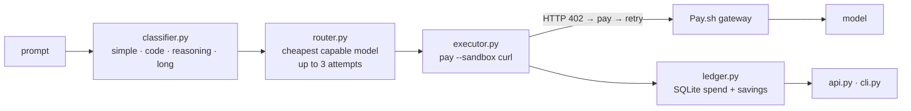

# SolRouter

**Stop paying premium prices for easy prompts.** SolRouter reads each prompt, sends it to the
cheapest model that can handle it, and pays for the call over HTTP 402 with
[Pay.sh](https://solana.com/docs/payments/pay-sh) stablecoins on Solana. No API keys, no
subscriptions: every call is paid for individually.


In the bundled demo, five prompts cost **$0.037 instead of $0.10** at premium-only prices:
**63% saved**, with the same answers.

```text
❯ What is the capital of France?
The capital of France is Paris.
── mock-tiny · simple · $0.0010 · saved $0.0190 · mock-tiny · payment: simulated

❯ Write a python function that reverses a linked list
Here's an iterative solution in O(n) time and O(1) space: …
── mock-mid · code · $0.0050 · saved $0.0150 · mock-mid · payment: simulated

❯ Why does proof of stake need slashing? Explain step by step.
Proof of stake needs slashing because staking alone doesn't make misbehaviour costly. …
── mock-big · reasoning · $0.0200 · saved $0.0000 · mock-big · payment: simulated

❯ [fail:tiny] what is 2+2?
2 + 2 = 4.
── mock-mid · simple · $0.0060 · saved $0.0140 · mock-tiny ✗ → mock-mid · payment: simulated
```

The last prompt shows the fallback: the cheap model returned nothing, so SolRouter moved up a
tier and still came in under the premium price.

## How it works



| Prompt looks like | Category | Minimum tier | Demo model | Price per call |
|---|---|---|---|---|
| Short question | `simple` | cheap | `mock-tiny` | $0.001 |
| Code keywords or a code fence | `code` | mid | `mock-mid` | $0.005 |
| 4,000+ characters | `long_context` | mid | `mock-mid` | $0.005 |
| "why", "explain", "step by step" | `reasoning` | premium | `mock-big` | $0.02 |

- **Fallback:** if a model fails or returns an empty answer, the next candidate is tried, up to three attempts.
- **Budget caps:** a per-request `max_price_usd` and a daily cap (`SOLROUTER_DAILY_CAP_USD`) reject anything that would overspend.
- **Ledger:** every call is recorded in SQLite with its cost and the premium baseline, so `GET /stats` reports the savings. Only prompt hashes are stored, never the prompts.
- **Sells itself too:** `paywall.yml` puts SolRouter's own `/ask` behind a Pay.sh gateway at $0.01 per call.

## Quick demo (2 minutes)

Needs Python 3.11+, Node 20+ and curl.

```sh
git clone https://github.com/YusufElloumi/solrouter.git
cd solrouter/solrouter

# 1. Python deps
python3 -m venv .venv && .venv/bin/pip install -r requirements.txt

# 2. Pay.sh CLI (project-local; demo.sh and the executor find it in .tools/)
npm install --prefix .tools @solana/pay@1.0.26   # npm wrapper 1.0.26 = native pay 0.26.0
# or put `pay` on PATH: npm install -g @solana/pay / brew install pay

# 3. Run the whole demo
./demo.sh
```

`demo.sh` starts everything it needs in the background (mock model on :8101, its Pay.sh
gateway on :8401, the SolRouter API on :8010), then:

1. sends an unpaid request to a metered model and shows the **HTTP 402**,
2. routes five prompts (simple, code, reasoning, long input, forced fallback) and prints each
   answer with a summary line: `── model · category · cost · saved · attempts · payment: …`,
3. shows the per-request **budget cap** rejecting a prompt,
4. prints **`GET /stats`** (total spent, saved vs premium, savings %, per-model usage).

The first run takes about 15 seconds while the sandbox gateway funds its wallets. Variants:

```sh
rm -f .run/demo.db .run/pay_down   # fresh ledger + retry real payment
MODE=simulate ./demo.sh            # always simulate payment
MODE=pay ./demo.sh                 # real Pay.sh payment only (see Limitations)
PAY_BIN=/path/to/pay ./demo.sh     # if `pay` isn't on PATH
.venv/bin/python cli.py -v "your prompt"   # one prompt, logs to the terminal
.venv/bin/python -m pytest -q      # tests
```

Stop everything: `pkill -f mock_model.py; pkill -f "gate api"; pkill -f "uvicorn api:app"; pkill -f pay_api_shim.py`

### What `payment:` means

The `payment:` field on each summary line reports what actually happened:

- `Pay.sh sandbox`: a real sandbox payment went through (test funds).
- `Pay.sh MAINNET (real USDC)`: a real model was paid for with real money (see [Real models](#real-models-mainnet-usdc)).
- `simulated`: Pay.sh was unavailable, so the price quoted in the real 402 was recorded but
  **no payment was sent**. The sample output above is from a simulated run.
- `unpaid`: `direct` mode, which bypasses the gateway.

Logs go to `.run/solrouter.log`.

## Use it

```sh
# CLI
.venv/bin/python cli.py "Write a python function that reverses a list"
.venv/bin/python cli.py "Why is the sky blue?" --max-price 0.05 --min-tier mid

# HTTP API
.venv/bin/uvicorn api:app --port 8010
curl -X POST localhost:8010/ask -H 'content-type: application/json' \
  -d '{"prompt":"why is the sky blue?","max_price_usd":0.05}'
curl localhost:8010/stats ; curl localhost:8010/models
```

| Endpoint | What it does |
|---|---|
| `POST /ask` | `{prompt, max_price_usd?, min_tier?}` → answer, model, category, cost, saved, attempts, payment |
| `GET /stats` | total spent, premium baseline, saved, savings %, per-model usage, spent today |
| `GET /models` | the model table from `models.json` |

### Run the pieces by hand

```sh
# 1. mock upstream model + its paid gateway
.venv/bin/python mock_model.py                                   # :8101
pay --sandbox gate api mock_paywall.yml --bind 127.0.0.1:8401    # :8401

curl -i -X POST http://127.0.0.1:8401/v1/tiny -H 'content-type: application/json' -d '{"prompt":"hi"}'   # -> 402
pay --sandbox curl -X POST http://127.0.0.1:8401/v1/tiny -H 'content-type: application/json' -d '{"prompt":"hi"}'

# 2. SolRouter as a paid endpoint ($0.01 per /ask)
pay --sandbox gate api paywall.yml --bind 127.0.0.1:8402
pay --sandbox curl -X POST http://127.0.0.1:8402/ask -H 'content-type: application/json' -d '{"prompt":"hi"}'
```

Fallback demo: the mock returns empty text for a model named in a `[fail:<model>]` marker,
e.g. `cli.py "[fail:tiny] what is 2+2?"` → `mock-tiny ✗ → mock-mid`.

## Real models (mainnet USDC)

`models.mainnet.json` routes to real Qwen models on Alibaba Cloud Model Studio's Pay.sh gateway
(catalog `solana-foundation/alibaba/modelstudio`). There are no API keys: each call is paid
in **real mainnet USDC** over HTTP 402. Calls are priced per token, so short prompts cost fractions
of a cent.

| tier | model | strengths | $ per 1M tokens in / out | worst case per call* |
|---|---|---|---|---|
| cheap | `qwen3.5-flash` | simple | 0.10 / 0.40 | ≈ $0.0011 |
| mid | `qwen3-coder-flash` | code | 0.30 / 1.50 | ≈ $0.005 |
| mid | `qwen3.5-plus` | simple, code, long_context | 0.40 / 2.40 | ≈ $0.008 |
| premium | `qwen3.8-max` | everything, incl. reasoning | 1.999 / 5.996 | ≈ $0.038 |

\*At `max_output_tokens` plus a 20K-char prompt. Routing and budget checks use this upper bound. The cost
recorded is computed from the token `usage` each response reports, at the catalog rates (still
marked estimated, because `pay curl` doesn't print the amount it settled).

One-time setup (interactive, so run it yourself):

```sh
.tools/node_modules/.bin/pay setup     # creates your mainnet Pay account (OS keychain)
.tools/node_modules/.bin/pay topup     # fund it; $1 of USDC covers hundreds of calls
.venv/bin/python pay_api_shim.py &     # hosted balance API is down (see Limitations)
PAY_API_URL=http://127.0.0.1:8498 .tools/node_modules/.bin/pay whoami   # should show your USDC
```

Then:

```sh
export SOLROUTER_MODELS=models.mainnet.json PAY_API_URL=http://127.0.0.1:8498
.venv/bin/python cli.py "What is the capital of France?"   # → qwen3.5-flash
.venv/bin/python cli.py "Why does proof of stake need slashing?" --max-price 0.05
```

Safety rules for mainnet models: they never fall back to `simulate` or `direct`, so a failed payment
is reported as a failure instead of a faked answer. Calls go through `pay curl` without
`--sandbox`. `SOLROUTER_DAILY_CAP_USD` (default $1.00) caps total spend per day.

## Configuration

All optional. Set them in your shell or prefix the command; nothing reads a `.env` file. Tested with `pay` 0.26.0.

| var | default | meaning |
|---|---|---|
| `PAY_BIN` | `pay` on PATH, else `.tools/node_modules/.bin/pay` | path to the pay CLI |
| `PAY_API_URL` | hosted (`demo.sh`: `http://127.0.0.1:8498`) | where `pay` looks up wallet balances; point at `pay_api_shim.py` while the hosted pay-api is down |
| `SOLROUTER_EXEC_MODE` | `auto` | `auto` = try real payment, fall back to `simulate` for 5 min if Pay.sh fails; `pay` = real `pay --sandbox curl` only; `simulate` = **fake payment**: real 402 + gateway-quoted price, settlement skipped, answer fetched from upstream; `direct` = unpaid bypass, models.json prices |
| `SOLROUTER_MODELS` | `models.json` | model table: `models.json` = local mocks (sandbox), `models.mainnet.json` = real Qwen models (**mainnet USDC**) |
| `SOLROUTER_DAILY_CAP_USD` | `1.00` | daily spend cap across all requests |
| `SOLROUTER_DB` | `solrouter.db` | SQLite ledger |
| `SOLROUTER_CALL_TIMEOUT_S` | `60` | per-upstream-call timeout (clamped 1–300) |

To add a model, add an entry to a model table (URL, request template, response path, tier,
strengths, `network`, and either `price_usd_per_call` or `in_usd_per_mtok` + `out_usd_per_mtok`
+ `max_output_tokens`). To swap the keyword classifier for an LLM one, implement the
`classifier.Classifier` protocol.

## Real vs mocked / estimated

- **Real:** `pay` CLI 0.26.0, `pay gate api` gateways (both YAMLs load), HTTP 402 challenges, sandbox wallet funding (100 SOL + 1000 USDC confirmed on the sandbox RPC), routing, fallback, budget caps, ledger.
- **Mocked:** the models in `models.json` (`mock_model.py` returns canned answers for the demo prompts and generic text otherwise). The default demo uses these.
- **Real (opt-in):** the Qwen models in `models.mainnet.json`, paid in mainnet USDC. Verified: model IDs exist and the gateway returns a mainnet 402 (session intent, USDC/USDT/PYUSD/CASH/USDG). **Not yet verified: a completed paid call.**
- **Estimated:** costs in `pay` mode. `pay curl` does not print the amount paid, so cost = `price_usd_per_call` from `models.json` (charged only when the gateway delivered a 2xx) and `cost_is_estimated=true`. In `simulate` mode the cost is the price the gateway quoted in its 402.

## Limitations / known issues

- **Hosted pay-api is down, so a local shim stands in for it.** Before paying, `pay --sandbox curl`
  asks Pay's hosted API for the wallet's stablecoin balance (`GET /v1/balance/stablecoins`). That
  host (`pay-api.gateway-402.com`) currently returns NXDOMAIN, so the CLI reads the balance as zero and
  fails with "wallet … does not have enough balance on `localnet`", even though the wallet holds 1000
  sandbox USDC on the Surfpool RPC. `pay_api_shim.py` (127.0.0.1:8498) answers that one endpoint
  from the sandbox RPC, and `demo.sh` sets `PAY_API_URL` to point the CLI at it. Signing and settlement
  are still done by `pay` against the sandbox RPC. The shim only replaces the balance lookup, is read-only
  and sandbox-only. Set `PAY_API_URL=` (empty) to go back to the hosted API once it resolves again.
  In `auto` mode, if paying still fails, SolRouter falls back to `simulate` (no payment sent) and
  labels the call `payment: simulated`.
- "Sandbox" is not offline: it uses the hosted Surfpool RPC `https://402.surfnet.dev:8899` and `pay-api`.
- Schema discrepancy: `pay server scaffold` emits `forward_url:` + `accounting: pooled`
  (see `scaffold.paywall.yml`); the bundled docs use `routing.type: proxy`. The gateway accepts the latter, which these YAMLs use.
- `pay curl --help` without an account tries `pay setup` (keychain) instead of printing help; use `pay help curl`.
- Developed on Python 3.11 (3.12 not installed); no 3.12-only features used.
- Classifier is keyword/length rules (`classifier.Classifier` protocol is the swap point for an LLM classifier).
